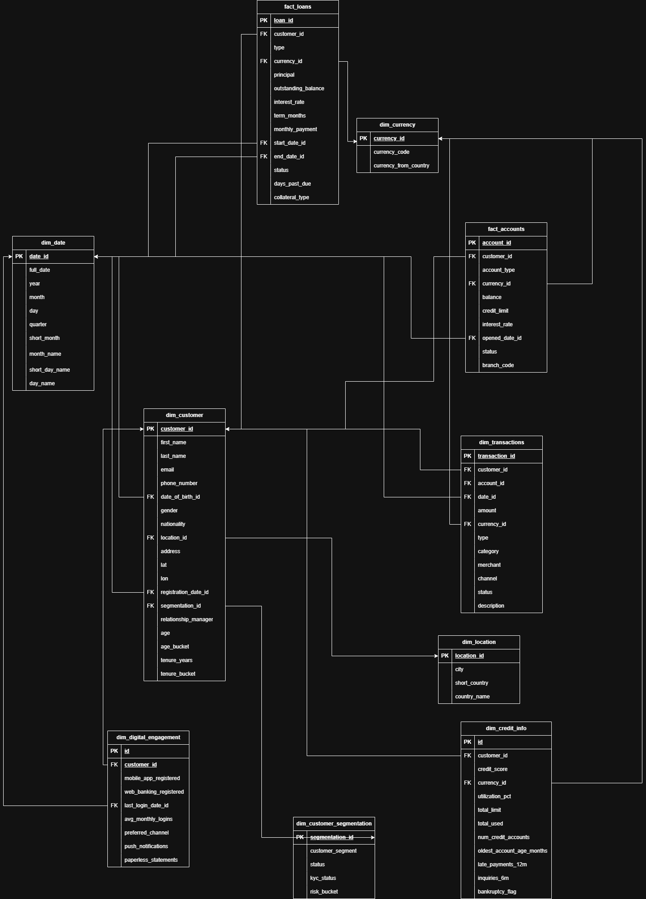

# qversity-data-2026-cali-victorvalencia
#Qversity's final challenge

#About Me
My name is Victor Valencia, i'm a system engineer student from the Universidad del Valle 

#How to run the pipeline
##prerequisites:
    Docker installed and running
    -PowerBI
    -Python 3.11 or superior
##Environment setup:
    You need to create an .env file with the values specified inside the env.example file
##How to start the program:
    1. Once you have docker running, run the following command in the terminal
    2. `docker compose up -d --build`
    3. Now wait for the containers to be ready
##Running the airflow DAGs
    1. Go to your browser and enter in this URL
    
        [localhost:8080](http://localhost:8080)
    
    2.login using the airflow default credentials
        -user:
        `admin`
        -password:
        `admin`
    3.Once you login succesfully, you will see three separate DAGs
    qversity_dag
        This is the main DAG, This is the main DAG that runs the whole pipeline, it follows this task order
        1. download_from_source
            Download the .json file to the local directory from the S3 server
        2. wait_for_file
            It's a senser that check if the file exist in the directory, if exists, the DAG continue
        3. load_to_postgres_bronze
            Create a new schema and table called bronze and raw_fintech_data respectively in the database, 
            then save the raw records from the .json file in the new schema and table
        4. bronze_to_silver
            Run a spark script that parse the raw records and convert them into a relational model (stg_customer), 
            then extract the transactions, accounts and loans columns, which are nested array columns, and flatten each one to put them on new tables staging tables
        5. silver_to_gold
            Run the dbt run command to flatten nested objects digital_engagement and credit_info columns and normalize values and tables across all silver tables,
            then creates the main fact and dimension tables and create data marts for further analysis in PowerBI,
            have in mind that this DAG runs automatically when you run the containers for the first time

    dbt_only_dag
    This DAG only runs the fifth task from the qversity DAG to avoid creating new duplicated records on the raw_fintech_data table; Use it only in development

#Architecture

    ##Layers
        ###Bronze
            This is where the raw data exists, the data is ingested from an JSON file downloaded from a S3 amazon server, then is saved into the bronze database schema, each raw record is saved as a JSONB column in the raw_fintech_data table, along with a timestamp column to know when the record was saved, the records are extracted
        ###Silver
            The data is extracted from the bronze layer and loaded into spark, then the data is parsed as DataFrames and the nested array columns are flattened, then parsed and saved into new relational tables in the silver schema, also the data is deduplicated in the process, then DBT runs and normalize values and nested object columns are saved as new tables
        ###gold
            Finally the fact and dimension tables are created, along with data marts that resumes the information for further analysis in BI tools like PowerBI

    ##Technologies
        ###Airflow
            Airflow works as the ELT orchestrator, schedules, automate and monitor the whole data pipeline, ensuring it's functioning
        ###Spark
            Extracts the raw data from the database, flattens nested arrays and drop duplicate records,
        ###PostgreSQL
            Stores the date, including the bronze, silver and gold layers
        ###DBT
            Normalize nested objects and values, creates the final facts models, dimension models and datamarts that resumes the informations, also utilizing the test feature to ensure
            data an referential integrity across all models

#Spark script

    The spark script is responsible of processing the raw data from the bronze schema through JDBC, the the data is parsed and converted into a Spark DataFrame, 
    Then a function called flatten_and_dedup three times, one for each a nested array column, transactions, loans and accounts. the flatten_and_dedup function firstly flattens the column using a generic function called flatten_array_column, extracting the array into a new spark dataframe, then drop the duplicated records with the specified columns and save that dataframe in a new table in the silver schema as
    staging tables. Finally the columns from the main customer dataframe are drop and the duplicated records too, then the it's saved into the silver schema.

#ERD
    This is the final resulting model

    